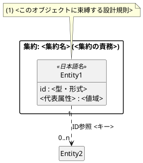

# 成果物の様式

設計ディレクトリ 1 つ (`<置き場>/` — SKILL.md の「1. 置き場を決める」で決めたもの) が持つファイルと、それぞれの書式。SKILL.md の手順から Read される。

## 配置骨格

```
<置き場>/
├── README.md          # 導入 + 目的 + 索引 + ドメインモデル図の貼付 + 用語集 (条件付き) + 検証シナリオ + 判断基準 (条件付き) + 省略の宣言 (条件付き)
├── system.md          # システム関連図 (境界・port の表)
├── usecases.md        # ユースケース (テキスト。図は置かない)
├── domain.puml        # ドメインモデル図の正本
├── domain.svg         # 描画結果 (生成物。domain.puml と必ず対で更新する)
├── statechart.puml    # 状態機械を持つ設計のみ。描画結果 statechart.svg も同様
├── rationale.md       # 根拠と退けた案
├── observations/
│   └── YYYY-MM-DD-<slug>.md # 日付つきの観測の記録 (根拠に要る観測があるときだけ・不変)
└── decision/
    └── NNNN-<slug>.md # 設計局所の決定記録 (1 決定 1 file・不変)
```

## README.md

設計ディレクトリの入口。次の節を持つ:

1. **導入**: 何の設計かを 1 段落。設計手法 (目的 → システム関連図 → ユースケース → ドメインモデル図 の順で作る) は名乗るだけでよい — 手法の説明は書かない
2. **目的**: 下記「目的」の形で書く。目的の正本は README で、他の成果物には書き写さない
3. **索引**: file / 中身 の 2 列表。**この表が更新時の正本対応表を兼ねる** — 「何を変えるときどの file を先に直すか」が読めるよう、各行の「中身」に扱う構造 (目的 / 境界 / ユースケース / entity・多重度・状態機械) を書く
4. **ドメインモデル図の貼付**: `[](domain.svg)` でクリック時に等倍で開く形。正本は `.puml` 側で `.svg` は生成物であること、直すのは source 側であることを 1 行添える
5. **用語集** (リポジトリに用語の正本が無い場合のみ): 下記「用語集」
6. **検証シナリオ**: [verification.md](verification.md) の様式
7. **判断基準** (図の note にもユースケースにも載らない判断の規則を持つ場合のみ): 下記「判断基準」
8. **省略の宣言** (成果物を省いた場合のみ): 何を省き、なぜその設計では不要かを 1 行ずつ

## 目的

- 達成したい状態を、利用時品質 (ISO/IEC 25019 の quality in use) の特性ごとに、人の体験で書く。表の列は `# | 誰の | 体験 | 特性`
- 「誰の」には人 (直接使う人・保守する人・運用する人) だけを置く。機械の呼び出し元 (工程・テスト) が要ることは、体験を支える保証として書く
- 特性の欄は必須にする。利用時品質の特性に当たらない行には、当たらないことと代わりの分類を書く
- 体験どうしが食い違ったときの優先順位を、1 行に 1 つ書き、(O) の番号を振る。食い違う軸が無ければ、無いと書く
- 体験を支える保証を、1 行に 1 つ書き、(P) の番号を振り、支える体験の番号を添える

## 判断基準

- 主題ごとに見出しを立て、目的・完了条件・制約・見直し条件・根拠への参照の 5 欄で書く
- 目的の欄は 1 つにし、「目的」の体験の番号を引く
- 当てる範囲の欄は、要る主題だけに置く。制約の群ごとに当てる範囲が違えば、主題を分ける
- 完了条件は 1 行に 1 つ書き、(K) の番号を振る。ユースケースの成功保証に当たるときは、成功保証の番号を引く
- 制約は 1 行に 1 つ書き、(C) の番号を振る
- 根拠への参照は、rationale.md の同じ名前の見出しを指す

## 番号

規則には番号を振り、引くときは節か主題の名前と番号を並べる。

| 規則 | 番号 | 一意にする範囲 |
|---|---|---|
| 目的の体験 | 表の # 列の数字。引くときは「体験 <n>」と書く | 設計 doc |
| 目的の優先順位 | `(O<n>)` | 設計 doc |
| 体験を支える保証 | `(P<n>)` | 設計 doc |
| 設計規則 | `(<n>)` | 設計 doc |
| system.md の境界・接続・状態機械の規則 | `(B<n>)` | system.md |
| ユースケースの成功保証 | `(UC<ユースケースの番号>-<n>)` | 設計 doc |
| 共通の保証 | `(G<n>)` | usecases.md |
| 共通の Extension | `(X<n>)` | usecases.md |
| 判断基準の完了条件 | `(K<n>)` | 主題 |
| 判断基準の制約 | `(C<n>)` | 主題 |

- 設計規則の番号は接頭辞の無い数字にする — note の番号を機械で読む検査が、行頭の `(数字)` だけを読める形に保つ
- system.md の規則が設計規則と同じなら、本文を書かずに設計規則の番号を引く。system.md の規則を設計規則の続き番号にしない
- 表に無い種類の規則は、設計の README の記述規約で接頭辞を宣言する
- 枝番 (`G1a` など) は、既に引かれている番号の規則を分けるときだけ使う。新しい規則は連番にする。設計規則には枝番を使わない

## system.md — システム関連図

図ではなく**表**で書く (ASCII 図は罫線の桁揃えが壊れやすく、表なら diff も編集も安定する)。

1. **システム境界**: どこに境界を引くか、境界の外に居るアクターは誰か。規則は 1 行に 1 つ書き、(B) の番号を振る
2. **システム × 相手 × 方向 の表**:

   | 相手 | 境界 | 経由 | 方向 | やり取りするもの |
   |---|---|---|---|---|

   経由列には port (交換可能にしたい接続点) を置き、port にしない相手はその旨を書く。port の切り方は変動性 (volatility) で決め、判断を表の下に (B) の番号の規則として書く
3. **状態機械** (持つ設計のみ): 状態の一覧と遷移の主系列をテキストで。正本の図は `statechart.puml`。規則は 1 行に 1 つ書き、(B) の番号を振る
4. **解こうとしている構造課題** (既存機構の置き換えなら): 現行の何が問題かを列挙する

**根拠と退けた案は rationale.md に置く**: 各節の末尾に、見直し条件と、rationale.md の同じ名前の見出しへの参照を置く。

## 決定の見直し条件

設計 doc に書く決定には、根拠と退けた案 (置き場は下記「rationale.md」) に並べて、その決定を見直す条件 (見直し条件) か、それを置かない理由を添える — 次に設計を改善する側が、なぜ今の形なのかと、何と比べて良くなったと言えるのかを辿れるようにするため。

- **形**: 「観測する量・閾値・超えたら見直す判断」の 3 つを 1 項で書く (`見直し条件: <観測する量>。<閾値>を超えたら、<見直す判断>を見直す`)。観測する量と閾値、置かないときはその理由も決定の一部なので、決定と一緒にユーザーに確かめて決める
- **観測する量**: 実挙動の監査 (実行の記録を読んで、設計どおりに動いたかを確かめる作業) が測れるもの (工程ごとの所要・subagent 数・turn 数・token、invoke ごとの skill 本文の注入字数、実行の記録から数えられる件数) に限る。監査が測れない量を置くと、照らす手段が無いまま見直し条件だけが残る。測れる量の無い決定 (境界の置き方・entity の切り方など) には見直し条件を置かず、見直し条件の代わりに置かない理由を書く (例: `見直し条件: 置かない (<測れる量が無い理由>)`) — 形だけ合わせた量をこしらえると、監査が照らしても決定の良し悪しを言えない
- **置く位置**: 判断基準の主題では見直し条件の欄に置き、主題のすべての制約を覆う (番号の範囲で括ってよい)。ユースケースと目的では、節に 1 つ置く。system.md の節・共通の保証・共通の Extension では、節の末尾に番号の範囲で括って置く。設計規則では、設計規則の一覧を置く節があればその末尾に、無ければその規則を引く system.md の節の末尾に置く。decision/ の file では `## 見直し条件` の節に置く (見出しが `見直し条件:` を兼ねる)。置かない理由も同じ位置に書く

## 読みやすさの基準

[verification.md](verification.md) 段 4 が、書いた経緯を知らない読み手に次の 2 段を照らさせる。

**形によらない基準** (どの設計 doc にも当てる):

1. 主題 (判断の規則をまとめた見出し) を見出しで引ける — 1 つの主題の記述が、その主題を名乗る見出しの下にまとまっている。1 つの主題は目的を 1 つ持つ
2. 1 行に規則が 1 つ — 片方だけを破れる 2 つの記述は別の行に分け、1 つの述語に付く条件・例外・列挙は同じ行に残す (ISO/IEC/IEEE 29148 の singular)
3. 規則を番号で名指せる
4. 規則と、根拠・却下肢・挿話が混ざっていない — 行か節で分かれていて、規則だけを照らす読み手が残りを読まずに済む
5. 主題ごとに、目的・完了条件・制約・見直し条件を引ける — 欄の名前は問わない (ユースケースなら Primary Actor の目標が目的に、成功保証が完了条件に当たる)。目的・system.md の各節・共通の保証・共通の Extension・設計規則は、見直し条件だけを引ければ足りる。見直し条件は、置かない理由が書いてあれば引けたとみなす

**宣言した形**: 設計 doc の README か、設計 doc を束ねるディレクトリの README の記述規約が形 (欄・番号の振り方・file の分け方など) を宣言していれば、その形にも照らす。記述規約がこの file の様式を引いていれば、この file の「目的」「判断基準」「番号」「rationale.md」「observations/」の節を宣言した形として照らす。宣言が無ければ、形によらない基準だけを当てる。

## usecases.md — ユースケース

Cockburn (Writing Effective Use Cases) の fully dressed を縮約した形。**テキストが中心成果物で、図は置かない。**

- 1 ユースケース = 1 見出しで、見出しは `UC<番号> <名前>`。フィールドは **Primary Actor / Scope / Level / Trigger / 事前条件 / 成功保証** を箇条書きで固定する
- 成功保証は 1 行に 1 つの箇条で書き、`(UC<番号>-<番号>)` を振る
- 複数のユースケースに共通する保証と例外は「共通の保証」「共通の Extension」に 1 回だけ書き、(G)・(X) の番号を振る
- **Main Success Scenario**: 番号付きリスト。1 ステップ 1 文・アクターを明記・**意図**を書く (どの tool をどう呼ぶかの詳細は書かない)。**3〜9 ステップ**に収める。超えるならユースケースを分割する
- **Extensions**: 分岐点を `<step 番号><英字>` で示し (例 `2a.`)、内部ステップは `2a1.` 形式。復帰先を明記する
- **Level は user-goal 固定**。単独の操作 (サブ機能) には降りない — それらは user goal の Main Success Scenario の 1 ステップとして現れる
- Scope は全ユースケースで設計対象システムに固定する。システムを使う側 (人間・外部システム) は境界の外のアクター
- 冒頭にこの記述規約を置く (読み手が規約を探しに来なくて済む)

## domain.puml — ドメインモデル図

PlantUML の簡略クラス図。冒頭コメントに次の記述規約を書き、本文が従う:

1. **全属性に `{field}` を必須とする。** PlantUML は `()` の有無でフィールド / メソッドを判定するため、`(gh#386)` のような括弧を含む属性は `hide methods` 系の設定下でメソッド扱いされ、画像から無言で消える (構文検査は exit 0 のまま)。`scripts/render-puml.py` がこの規約を機械検査する
2. **検査は必ず exit code で判定する。** `-tsvg` / `-tpng` は syntax error でもエラー画像を生成して exit 0 を返しうるので、生成物の有無を成功判定に使わない

書く装置は 4 つ:

- **簡略クラス図**: 代表属性のみ・メソッドは書かない (`hide circle` / `hide empty members`)
- **設計規則は note** で所有オブジェクトに束縛する (そのオブジェクトが実装する)。1 行に 1 つ書き、行頭に `(<番号>)` を書く。根拠は note に書かない
- **集約は package 枠**で囲む
- **集約間は ID 参照** (`..>`) + **多重度**

骨格:



## statechart.puml — 状態遷移図 (状態機械を持つ設計のみ)

`scripts/check-statechart.py` が検査できる記法の範囲で書く (対応記法・`uncovered` 宣言の形は script の `--help` が正本)。**未定義にする組合せには理由の宣言が要る** — 検査の意図と使い方は [verification.md](verification.md)。

## 用語集

用語の正本はリポジトリに 1 箇所。**対象 repo の `docs/agents/domain.md` が用語集を案内していればそちらへ追記**し、設計ディレクトリからは参照する。案内が無ければ README.md 内に対訳表を置く:

| 語 | 日本語 | 意味 |
|---|---|---|

- ドメインモデル図に登場する語 (entity 名・状態名・イベント名) は全部この表に載せる — 図の語彙と地の文の語彙のずれが、実装時の名前の割れになる
- 設計中の新造語のために用語集ファイルを新設しない (設計が固まってから、リポジトリの運用に従って昇格する)

## rationale.md — 根拠と退けた案

根拠と退けた案は、決定を述べた file には書かず rationale.md に置く。README の索引に、決定を変えるときに読む file として載せる — 変更を設計に照らす読み手が読まずに済む。

- 見出しは、決定を述べた節 (README の「目的」・system.md の節・usecases.md の節) か判断基準の主題と同じ名前にする。設計規則の根拠は「設計規則」の見出しに置く
- 1 行に 1 つ、`根拠 (<番号>): <文>` か `却下 (<番号>): <案>。理由: <理由>` で書く。番号は、同じ名前の節か主題の規則の番号
- 日付つきの観測 (いつ・何を測り・いくつだったか) は書かない。観測から言えることを文で書き、observations/ の file を引く
- 冒頭に、決定を変えるときに読む file であることと、番号の指し先を書く
- decision/ に記録がある決定も、今の根拠と退けた案は rationale.md に書く。decision/ は決定した時点の記録で、覆した経緯を辿るときに読む

## observations/ — 観測の記録

根拠に要る日付つきの観測を、1 回の観測 (監査・実行・試行) につき 1 file で置く。file 名は `YYYY-MM-DD-<slug>.md` (日が分からない観測は `YYYY-MM-<slug>.md`)。**記録は不変** — 後の観測は新しい file に書く。

```markdown
# <何を観測したか>

- Date: YYYY-MM-DD (日が分からなければ YYYY-MM)

## 対象と方法

<何を・どう測ったか>

## 結果

<数えた値。1 行に 1 つ>
```

- 観測から言えることは書かず、rationale.md に書く
- 根拠に引かれない観測は置かない

## decision/ — 決定記録

設計セッション中の決定のうち、**根拠と却下肢を残す価値があるもの**を 1 決定 1 file で蓄積する。file 名は `NNNN-<slug>.md` (4 桁連番)。**記録は不変** — 覆すときは新しい決定 file を起こし、旧 file の Status を Superseded にする。

```markdown
# NNNN. <決定を 1 文で>

- Status: Accepted | Superseded by NNNN
- Date: YYYY-MM-DD

## 決定

<何をどうすると決めたか>

## 根拠

<なぜその選択か>

## 却下した代替案

- <案>: <却下理由>

## 見直し条件

<観測する量>。<閾値>を超えたら、<見直す判断>を見直す | 置かない (<測れる量が無い理由>)
```

- **リポジトリ全体の ADR へ昇格する基準**: 決定がこの設計の外 (実装全体・他コンポーネント) を縛り、かつ覆すコストが大きいもの。昇格したら decision/ 側の file は本文を ADR への参照 1 行に置き換える (二重記述にしない)。ADR の起票はリポジトリの運用に従う
- decision/ に残す価値に満たない小さな却下肢は file を起こさず、rationale.md にだけ置く
